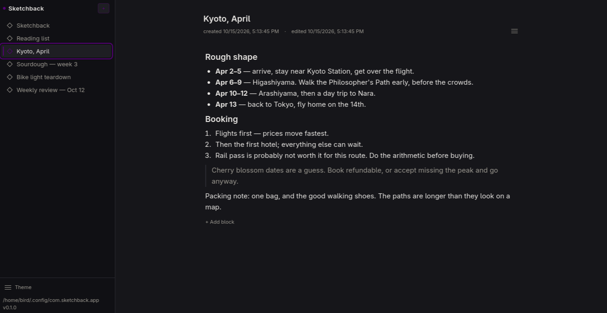
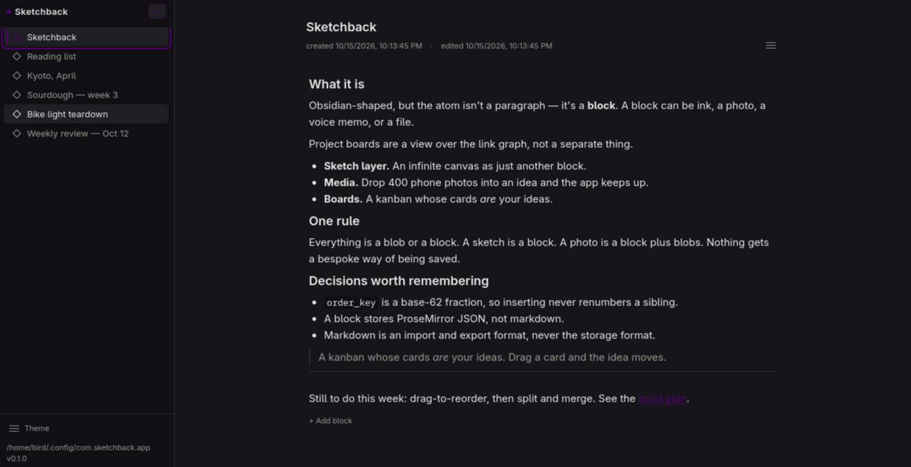

# Sketchback

An idea notebook for one person. Obsidian-shaped — folders of notes, markdown
in, markdown out — with one difference: the atom isn't a paragraph, it's a
**block**. A block can be text, ink, a photo, a voice memo, or a file. Project
boards are a view over the link graph, not a separate thing.

I'm building this alone. It's a desktop app — Tauri v2, React 19, TypeScript,
local-first, single user.

The spec is [`plan-final.md`](./plan-final.md). It's the source of truth; where
the code has drifted from it, the drift and the reason are written down.

## Download

Two single files, both built by CI:

| Platform | File | Needs |
| --- | --- | --- |
| Windows 10/11 | `Sketchback-0.1.0-portable-x64.exe` | WebView2 (Windows 11, and effectively all of Windows 10) |
| Linux x86_64 | `Sketchback_0.1.0_amd64.AppImage` | glibc 2.34+, FUSE2 (or `--appimage-extract-and-run`) |

Neither is an installer — nothing to install or uninstall. Your notes live in
`%APPDATA%\com.sketchback.app\` on Windows,
`~/Library/Application Support/com.sketchback.app/` on macOS, and
`~/.config/com.sketchback.app/` on Linux.

Neither file is code-signed, so Windows will show a SmartScreen warning until
you pick "More info" → "Run anyway". That's what any unsigned binary looks like.

**Testing status:** the AppImage has been run end-to-end. The Windows exe runs
on Windows 11, and that is all that has been confirmed.

## Status

What's here works. Most of the app isn't here yet — I'd rather be specific than
flatter myself.

Works today:

- Create, rename, delete and reopen ideas. They survive a restart.
- One editor per block, markdown going in and coming out.
- Every markdown element is a palette command on `Ctrl+K`.
- A slash menu for inserting blocks.
- Day / night / system themes, plus your own accent colour.
- Export an idea as a folder of linked `.md` files, ready for Obsidian.
- A seed script that fills the app with believable notes so it doesn't look blank.

Not there yet: sketches, photos, voice notes, files, boards, links, tags, search,
sync. There's no blob store, so export can't carry images or audio yet, and
`[[wikilinks]]` don't resolve to anything.

## Try it without building

There's a one-page demo at <https://liqwidcell-dot.github.io/sketchback/>.

## Getting started

```sh
git clone https://github.com/liqwidcell-dot/sketchback.git
cd sketchback
npm install
npm run tauri dev     # the desktop app, with HMR
```

Node 22.5+ and Rust 1.90+ are required. Tauri's system dependencies are covered
on [Tauri's prerequisites page](https://v2.tauri.app/start/prerequisites/).

Common scripts:

| Command | What it does |
| --- | --- |
| `npm run tauri dev` | The desktop app, hot reload |
| `npm run build` | Bundle the frontend |
| `npm run typecheck` | `tsc --noEmit` |
| `npm run seed` | Fill the app with demo notes |

`npm run seed` writes six realistic ideas into the app's SQLite file. It only
touches rows whose id begins `seed-`, so re-running is safe and never takes your
own notes. `--check` reads the database back and prints markdown, so a note that
doesn't round-trip is obvious.

## Where your data lives

Not inside a vault folder. `tauri-plugin-sql` puts the database at:

```text
Windows   %APPDATA%\com.sketchback.app\sketchback.db
macOS     ~/Library/Application Support/com.sketchback.app/sketchback.db
Linux     ~/.config/com.sketchback.app/sketchback.db
```

To start over, delete that file and relaunch.

## Layout

```text
src/main.tsx            the whole frontend — Platform, store, router, views
src/styles.css          Tailwind 4 entry + design tokens from plan §27
src-tauri/src/main.rs   the Rust shell — SQLite schema and migrations
scripts/                the export harness and the seed script
docs/index.html         the demo page — one static file, no build step
.github/workflows/      CI that builds the AppImage and the portable exe
plan-final.md           the spec
```

Files are intentionally few. Same-type code stays in one file until it earns a
split.

## Screenshots





More on the [demo page](https://liqwidcell-dot.github.io/sketchback/).
