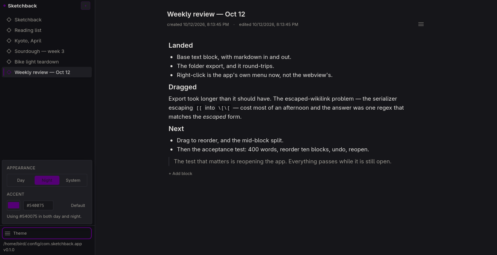

# Sketchback



An idea notebook for one person. Obsidian-shaped — folders of notes, markdown in, markdown
out — with one difference: the atom isn't a paragraph, it's a **block**. A block can be text,
ink, a photo, a voice memo, or a file. Project boards are a view over the link graph, not a
separate thing.

I'm building this alone. It's a desktop app — Tauri v2, React 19, TypeScript, local-first,
single user.

The spec is [`plan-final.md`](./plan-final.md), and it is the source of truth. Where the code
has drifted from it, the drift and the reason are written down.

## Download

Two single files, both built by CI:

| Platform | File | Needs |
| --- | --- | --- |
| Windows 10/11 | `Sketchback-0.1.0-portable-x64.exe` | WebView2 — present on Windows 11, and on effectively all of Windows 10 |
| Linux x86_64 | `Sketchback_0.1.0_amd64.AppImage` | glibc 2.34 or newer, and FUSE2 to mount it |

Neither is an installer. The Windows build is a bare executable: nothing to
install, nothing to uninstall, and your notes live in
`%APPDATA%\com.sketchback.app\`. On Linux, `chmod +x` the AppImage and run it,
or use `--appimage-extract-and-run` on a machine without FUSE.

Both carry their own runtime: the AppImage bundles webkit2gtk and its
JavaScriptCore, so the host does not need WebKit installed, and the exe links
the WebView2 loader statically, so it is one file with no DLLs beside it. The
AppImage is built on Ubuntu 22.04 and asks for glibc 2.34 — Ubuntu 22.04+,
Debian 12+ and RHEL 9+ all qualify.

Neither file is code-signed, so Windows will show a SmartScreen warning until
you pick "More info" → "Run anyway". That is what any unsigned binary looks
like, not a symptom of this one.

## Status

What's here works and is tested. Most of the app isn't here yet. Being specific about which is
which seemed better than a feature list that flatters itself.

Works today:

- Create, rename, delete and reopen ideas. They survive a restart.
- An editor per block, with markdown shortcuts going in and markdown coming out.
- Every markdown element is a command in the palette, on `Ctrl+K`.
- A slash menu for inserting blocks.
- Day / night / system themes, plus an accent colour of your own.
- Export an idea as a folder of linked `.md` files, ready for Obsidian or anything else.
- A seed script that fills the app with six believable notes, so it doesn't photograph like
  a blank page.

Not there yet: sketches, photos, voice notes, files, boards, links, tags, search and sync.
There is no blob store, so the export can't carry images or audio yet, and `[[wikilinks]]`
don't resolve to anything.

## Try it without building it

There's a one-page demo at <https://liqwidcell-dot.github.io/sketchback/>. The page is one
static file in [`docs/`](./docs) — that folder name is a GitHub Pages requirement for serving
a branch subfolder, not a design choice.

## Requirements

- **Node 22.5 or newer.** `npm run seed` talks to SQLite through `node:sqlite`, which landed
  in 22.5. (I'm running 26.)
- **Rust 1.90 or newer** — see `rust-version` in `src-tauri/Cargo.toml`.
- **Tauri's system dependencies.** On Arch:

  ```sh
  sudo pacman -S --needed webkit2gtk-4.1 base-devel curl wget file \
    openssl appmenu-gtk-module libappindicator-gtk3 librsvg xdotool
  ```

  Other distributions are covered on
  [Tauri's prerequisites page](https://v2.tauri.app/start/prerequisites/).

## Getting started

```sh
git clone https://github.com/liqwidcell-dot/sketchback.git
cd sketchback
npm install
npm run tauri dev     # the desktop app, with HMR
```

The first run compiles the Rust shell, which takes a few minutes. After that it's seconds,
and the frontend hot-reloads.

## Scripts

| Command | What it does |
| --- | --- |
| `npm run tauri dev` | The desktop app, with hot reload. |
| `npm run build` | Bundle the frontend into `dist/`. |
| `npm run typecheck` | `tsc --noEmit`. |
| `npm run preview` | Serve the built frontend in a browser — no Rust, no database. |
| `npm run check:export` | The export test harness, 72 cases. |
| `npm run seed` | Fill the app with demo notes. |

## Seeding

`npm run seed` writes six ideas of realistic notes straight into the app's SQLite file, so
the app looks like something rather than nothing. It only ever touches rows whose id begins
`seed-`, so re-running is safe and it will never take your own notes with it.

```sh
npm run seed              # add or replace the demo ideas
npm run seed -- --fresh   # also hide every non-demo idea (reversible)
npm run seed -- --list    # show the vault and exit
npm run seed -- --check   # print the stored demo text back out as markdown
npm run seed -- --dry-run # report what would change, write nothing
npm run seed -- --db PATH # use a specific database file
```

`--check` is the one worth knowing about: it reads the database back and prints markdown, so
a note that doesn't round-trip is obvious. It caught two authoring slips the first time it
ran, neither of which was visible in the source text.

## How it stores things

Worth knowing before reading the code.

- **A block is ProseMirror JSON**, in `block.data_json`. The editor's own document format is
  the storage format, so loading a block isn't a translation step.
- **Order is a fractional index.** `block.order_key` is a base-62 string, so moving a block
  rewrites one row instead of renumbering its neighbours.
- **Markdown exists only at the edges.** In via shortcuts and paste, out via `getMarkdown()`.
  Nothing is *stored* as markdown; the export converts on the way out.

## Where your data lives

Not inside a vault folder, which is where the plan wanted it. `tauri-plugin-sql` resolves
SQLite paths against the app-config directory, so the database is at:

```text
Windows   %APPDATA%\com.sketchback.app\sketchback.db
macOS     ~/Library/Application Support/com.sketchback.app/sketchback.db
Linux     ~/.config/com.sketchback.app/sketchback.db
```

Making it sit next to a user-chosen vault needs either an absolute-path connection string or
a switch to `rusqlite`. Deferred for now, and written down rather than quietly worked
around.

## Layout

```text
src/main.tsx            the whole frontend: Platform, store, router, views, palette, menus
src/styles.css          Tailwind 4 entry + the design tokens from plan §27
src-tauri/src/main.rs   the Rust shell: SQLite schema and migrations
scripts/                the export harness and the seed script
docs/index.html         the demo page — one static file, no build step
.github/workflows/      the CI that builds the AppImage and the portable exe
plan-final.md           the spec
```

Files are intentionally few. Same-type code is kept in one file: the plan's `platform/`,
`db/`, `views/`, `components/` split is collapsed until it earns its keep.

## Verifying

```sh
npm run typecheck               # 0 errors
npm run build                   # succeeds; Vite warns about one large chunk
npm run check:export            # 72/72
cd src-tauri && cargo test      # 5/5, mostly path-traversal refusals
```

The export harness is hand-rolled and lives in `scripts/`. Vitest will take it over.

## Screenshots


There are a couple more on the [demo page](https://liqwidcell-dot.github.io/sketchback/).

## Notes for whoever reads the code next

- `src/main.tsx` exports non-components (`platform`, `useStore`, …), so Vite's Fast Refresh
  falls back to a full reload on every edit. Harmless, mildly annoying, and the first
  concrete reason to split the file.
- The webview's native right-click menu is suppressed, which takes right-click-to-paste with
  it. `Ctrl+V` still works. In dev, **Shift+right-click** opens the inspector, because that
  menu was the only route to it on Linux — the branch is behind `import.meta.env.DEV`, so the
  minifier drops it from a production build.
- On first launch the database file is created, along with its single vault row and a device
  id kept in `localStorage`. Nothing else is written until you make an idea, and an idea
  always opens with somewhere to type. To start over, delete the file above and relaunch.
